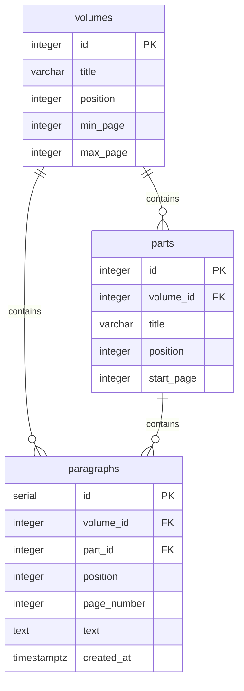

# Data Model

## PostgreSQL schemas

Application tables are grouped by domain. The table names in the diagrams below omit their schema prefix for readability.

| Schema | Tables |
| --- | --- |
| `corpus` | `volumes`, `parts`, `paragraphs` |
| `identity` | `users`, `password_reset_tokens`, `email_verification_tokens` |
| `library` | `quote_selections`, `tags`, `quote_selection_tags` |
| `admin` | `admin_mfa_credentials`, `admin_mfa_recovery_codes`, `admin_daily_metrics`, `admin_notification_settings`, `admin_notification_outbox` |

Flyway keeps `flyway_schema_history` in `public`; the `pg_trgm` extension and its operator classes also remain in `public`. The application uses Spring Security's in-memory HTTP sessions, so there are no Spring Session tables. `paragraphs.id` and the two token-table ID columns use owned sequences; PostgreSQL moves those sequences with their tables.

## Corpus

The corpus models the structure of _À la recherche du temps perdu_.

The hierarchy is intentionally simple:

- Volume
- Part
- Paragraph

Paragraphs are the fundamental unit of search, navigation and annotation.



### Key decisions

**`paragraphs.position`** is a global reading-order index across the entire work (unique). It is the canonical ordering key for search results and the future personal timeline.

**`paragraphs.volume_id`** is denormalized — it could be derived through `part_id → parts.volume_id`, but storing it directly avoids a join in the common case.

**`parts.start_page`** is used by the importer to assign each paragraph to its part: `WHERE start_page <= page ORDER BY start_page DESC LIMIT 1`.

**`paragraphs.page_number`** comes from the source text file itself (line markers like `001 |`), not from an external edition reference. It is stable across imports.

**`volumes.min_page`/`max_page`** are computed once by the corpus importer, right after paragraphs are inserted (`volumes` is seeded before any paragraph exists, so the bounds can't be known at seed time). Used by the personal timeline to position bookmarks and draw volume delimiters without recomputing an aggregate on every request. See [personal-timeline.md](../features/personal-timeline.md).

---

## User data

`users` (auth, MVP step 4), `quote_selections` / `tags` / `quote_selection_tags` (quote saving, MVP step 5), and `password_reset_tokens` / `email_verification_tokens` (auth token flows) are implemented. The pre-launch admin adds MFA credentials, aggregate daily registration/deletion metrics, notification settings and a minimal delivery outbox.

```mermaid
erDiagram
    users {
        uuid    uuid PK
        varchar username
        varchar email
        varchar password_hash
        varchar role
        boolean email_verified
        timestamptz created_at
    }

    quote_selections {
        uuid    id PK
        uuid    user_id FK
        integer paragraph_id FK
        integer start_offset
        integer end_offset
        text    selected_text
        text    comment
        timestamptz created_at
    }

    password_reset_tokens {
        bigserial id PK
        uuid      user_id FK
        varchar   token_hash
        timestamptz expires_at
        timestamptz used_at
        timestamptz created_at
    }

    email_verification_tokens {
        bigserial id PK
        uuid      user_id FK
        varchar   token_hash
        timestamptz expires_at
        timestamptz used_at
        timestamptz created_at
    }

    admin_mfa_credentials {
        uuid user_id PK_FK
        bytea secret_ciphertext
        bigint last_totp_counter
        timestamptz created_at
    }

    admin_mfa_recovery_codes {
        uuid user_id PK_FK
        char code_hash PK
        timestamptz created_at
        timestamptz used_at
    }

    admin_daily_metrics {
        date metric_date PK
        integer registrations
        integer account_deletions
    }

    admin_notification_settings {
        smallint id PK
        boolean registrations_enabled
        boolean deletions_enabled
        timestamptz updated_at
    }

    admin_notification_outbox {
        uuid id PK
        varchar event_type
        timestamptz created_at
        integer attempts
        timestamptz next_attempt_at
        timestamptz claimed_until
        timestamptz sent_at
        varchar last_error_type
    }

    users ||--o{ password_reset_tokens     : requests
    users ||--o{ email_verification_tokens : requests
    users ||--o| admin_mfa_credentials    : protects
    users ||--o{ admin_mfa_recovery_codes : recovers

    tags {
        uuid     id PK
        uuid     user_id FK
        varchar  name
        smallint color_index
        timestamptz created_at
    }

    quote_selection_tags {
        uuid quote_selection_id PK_FK
        uuid tag_id PK_FK
    }

    users          ||--o{ quote_selections     : saves
    paragraphs     ||--o{ quote_selections     : sourced_from
    users          ||--o{ tags                 : owns
    quote_selections }o--o{ tags               : tagged_with
```

`users.username` is nullable and remains unique when set. Existing usernames are retained; the UUID remains the stable user identity.

### Key decisions

**`users.uuid`** is a UUID (not a serial integer) — avoids enumerable user IDs in URLs and API responses. Generated in Postgres via `gen_random_uuid()` (built into Postgres 13+, no `pgcrypto` extension needed).

**Account deletion is physical and cascading for private user data.** Deleting a `users` row cascades to its saved quote selections (including personal comments), tags, quote-tag associations, password-reset tokens, and email-verification tokens. The corpus tables are independent and remain intact. The account-deletion endpoint re-verifies the current password and expires all active sessions before clearing the current session. See [ADR-018](ADR-018-permanent-account-deletion.md) and [password-management.md](../features/password-management.md#account-deletion).

**`quote_selections.id` and `tags.id` are UUID** (`DEFAULT gen_random_uuid()`), like `users.uuid` — not the original decision (see history below). Ownership is still enforced the same way it always was: every read, update and delete filters on `user_id` in the query itself (see [Feature doc](../features/quote-save-tags.md)) — the UUID doesn't replace that check, it's defense in depth on top of it. See [ADR-015](ADR-015-opaque-identifiers-for-user-owned-resources.md) for the general rule this follows and why it changed.

*History*: these two columns were originally `SERIAL`; migrated to UUID once the project had no production data left to migrate and changing a PK was still cheap. See ADR-015 for the full reasoning.

**`quote_selections.selected_text`** is stored alongside the offsets for display and debugging — if the corpus text were ever corrected, the saved text remains readable. Once a quote is saved, `selected_text`/`start_offset`/`end_offset` are immutable for now — only its tags and `comment` can change (full editing is a possible future iteration).

**`quote_selections.comment`** (`TEXT NULL`) is an optional personal comment, editable only after creation — never set at creation time. Empty/whitespace-only input is normalized to `NULL` in the service layer, never stored as an empty string. See [quote-save-tags.md](../features/quote-save-tags.md).

**`users.email_verified`** defaults to `FALSE` for new accounts; existing accounts were backfilled to `TRUE` by the migration that introduced the column. See [auth.md](../features/auth.md#email-confirmation-at-registration).

**Admin MFA secrets are reversible secrets, not password hashes.** `admin_mfa_credentials.secret_ciphertext` stores AES-GCM ciphertext; the encryption key is supplied outside the database through `ADMIN_MFA_ENCRYPTION_KEY`. Recovery codes are high-entropy and stored only as SHA-256 hashes, consumed atomically once. The accepted TOTP time counter is recorded atomically to prevent replay across the accepted clock-skew window. Credentials cascade with account deletion.

**Admin usage metrics are daily aggregates.** Registration and deletion totals are incremented transactionally in `admin_daily_metrics`, without retaining a user identifier or content. This preserves deletion counts after the account row and its private data are removed. Current quote and tag counts are calculated from live rows and exclude admin accounts.

**Admin notification outbox contains no user identity.** It records only the event type and delivery state, so failed mail can be retried without retaining an email, quote, user ID or request payload. The recipient is resolved from the current admin account at delivery time. Notification toggles default to enabled when the first admin is provisioned.

**`password_reset_tokens`/`email_verification_tokens`** each hold one-time tokens for their respective flow: `SecureRandom`-generated, stored hashed (`token_hash`, SHA-256, never the raw token), single-use (`used_at`), time-limited (`expires_at`). Kept as two separate physical tables (rather than one shared table with a `kind` column) so a bug in one flow's queries can't touch the other flow's data, even though the query logic itself is generalized. A partial unique index guarantees at most one active (unused, unexpired) token per user per table. See [auth.md](../features/auth.md#email-confirmation-at-registration) and [password-management.md](../features/password-management.md#token-lifecycle).

**Tagging is optional.** A quote selection can have zero tags; a tag can exist without being attached to any quote. The many-to-many relationship is genuinely `0..n ↔ 0..n` in both directions — there is no floor on either side.

**`tags`** are per-user and private — there is no shared tag taxonomy. Uniqueness is `(user_id, name)`, compared case-insensitively after trimming (a `CHECK` constraint guarantees `name` is always already trimmed and non-empty; a unique index on `(user_id, LOWER(name))` enforces the case-insensitive part) — so "Combray" and "combray" cannot both exist for the same user, while the casing a user actually typed is preserved for display.

**`tags.color_index`** (`SMALLINT NOT NULL DEFAULT 0`, `CHECK (color_index BETWEEN 0 AND 9)`) is a position in a fixed, predefined 10-color palette, not a stored color value — the palette itself lives in the frontend and can change without a migration touching every row. Chosen by the user at creation time (optional on the create request; defaults to slot 0 when omitted), immutable afterward — no endpoint changes a tag's color after creation yet.

**Domain schemas organize objects; they do not by themselves restrict access.** `DB_MIGRATION_USERNAME` / `DB_MIGRATION_PASSWORD` can configure Flyway separately from the runtime connection; local defaults use the same credentials. PostgreSQL grants are provisioned separately, while `USER` / `ADMIN` authorization remains in Spring Security and application logic. See [database-schemas.md](../features/database-schemas.md) for required role privileges.

## Offset convention

Quote selections are stored using character offsets within a paragraph.

- `start_offset` is inclusive.
- `end_offset` is exclusive.
- Offsets are zero-based.

This convention matches `String.substring()` in both Java and JavaScript and allows quote selections to be reconstructed deterministically from the original paragraph text.
